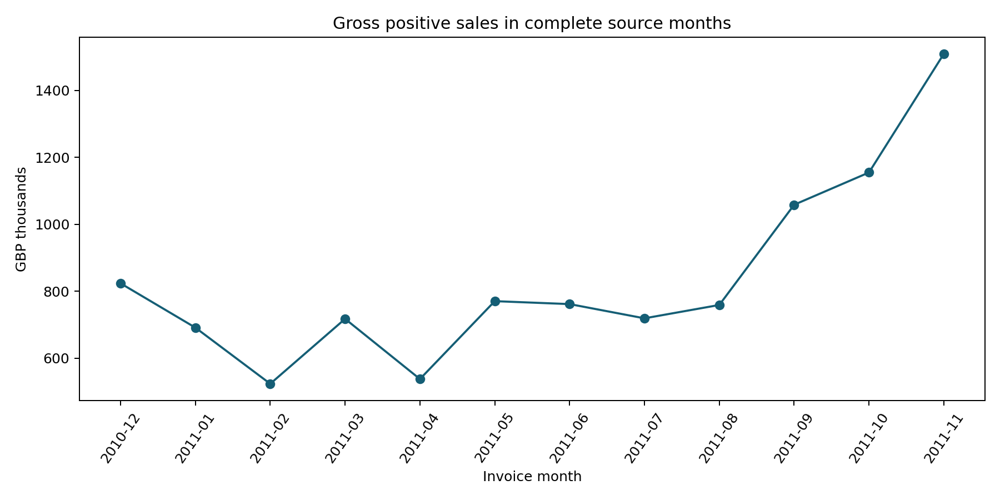
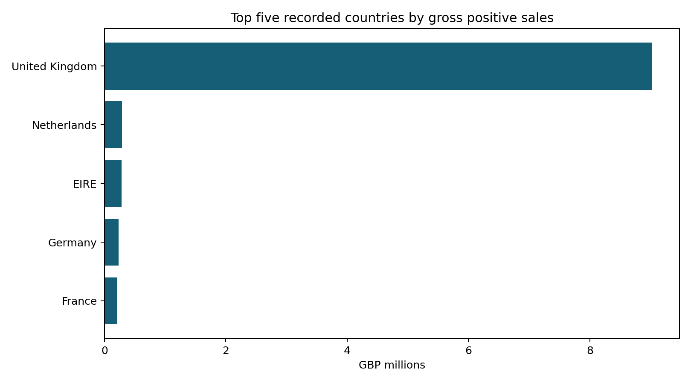

# Retail Sales and Customer Analysis

## Business question

How do positive sales vary by month and country, and how frequently do identified customers purchase again?

This PostgreSQL portfolio exercise supports a retail manager investigating sales concentration and purchasing patterns. It uses historical public data, not a commissioned client engagement.

## Data source and scope

Chen, D. (2015). [Online Retail](https://doi.org/10.24432/C5BW33). UCI Machine Learning Repository. The dataset is licensed under [CC BY 4.0](https://creativecommons.org/licenses/by/4.0/).

The source contains 541,909 invoice lines from 1 December 2010 to 9 December 2011. Amounts are in GBP. Each raw row is a line, not a complete order. The retailer includes wholesale customers.

Source, attribution and workbook fingerprint: [DATA_SOURCE.md](DATA_SOURCE.md). Field definitions: [DATA_DICTIONARY.md](DATA_DICTIONARY.md).

## Metric definitions

Gross positive sales is quantity × unit price for lines with:

- A known invoice number, stock code and invoice date.
- Positive quantity and unit price.
- An invoice number without a cancellation prefix.

It is not net revenue or profit. Duplicate-looking lines remain in the baseline. Anonymous eligible sales remain in sales totals, while customer metrics use known customer identifiers only.

Invoice values are calculated by summing lines before calculating average invoice value. Repeat customers have at least two eligible invoices within the observed window; this is not a cohort retention measure.

Monthly growth uses December 2010–November 2011. Other totals include the partial December 2011 period.

## Method

Python converts the workbook to CSV and records a source hash. PostgreSQL then profiles the raw data, filters valid sales, builds customer/invoice/line reporting tables and calculates six business reports.

The SQL uses exact decimal prices, primary and foreign keys, CTEs, conditional aggregation, LAG and DENSE_RANK. The invoice model uses the earliest eligible timestamp after checking that known customer and country attributes do not conflict.

| Object | One row represents |
|---|---|
| retail_raw | An original invoice line |
| valid_sales | An eligible positive-sales line |
| customers | An identified customer |
| invoices | An eligible invoice |
| sales_lines | An eligible source line linked to its invoice |
| invoice_totals | An invoice with its calculated total |

## Findings

| Metric | Result |
|---|---:|
| Eligible lines | 530,104 |
| Eligible invoices | 19,960 |
| Gross positive sales | £10,666,684.54 |
| Average invoice value | £534.40 |
| Identified customers | 4,338 |
| Repeat customers | 2,845 (65.58%) |
| Anonymous eligible invoices | 1,428 |
| Anonymous positive sales | £1,755,276.64 |

Sources: [Sales summary](outputs/sales_summary.csv), [repeat customers](outputs/repeat_customers.csv) and [anonymous sales](outputs/check_anonymous_sales.csv).

### Monthly sales

November 2011 was the highest complete month at £1,509,496.33, up 30.69% from October. The increase is a reason to investigate customer and product mix, not evidence of a specific campaign effect.



Source: [Monthly sales](outputs/monthly_sales.csv). The supplied line chart uses a nonzero vertical minimum; read changes from the labelled values and CSV.

### Country concentration

The United Kingdom contributed £9,025,222.08 across 18,019 invoices, approximately 84.61% of full-period positive sales.



Source: [Country sales](outputs/country_sales.csv).

### Customer purchasing and stock-code interpretation

Among 4,338 identified customers, 2,845 had at least two eligible invoices. Anonymous invoices are excluded from this denominator.

The highest-value stock code was DOT at £206,248.77. Its source description, checked during review, is DOTCOM POSTAGE. This ranking includes charges and should not be called a ranking of physical products alone.

Sources: [Repeat purchasing](outputs/repeat_customers.csv), [top stock codes](outputs/top_products.csv) and [top customers](outputs/top_customers.csv).

Full interpretation: [FINDINGS.md](FINDINGS.md).

## Validation and limitations

Saved checks show zero orphan lines and zero difference between line totals and invoice totals. Included and excluded lines reconcile to the raw count. The seven lines of invoice 536365 sum to £139.12, matching the saved manual-check values and invoice total.

I reported a successful model rerun with unchanged totals. An AI-assisted review independently recomputed the exported results from the submitted data; it did not rerun PostgreSQL. See [DATA_QUALITY.md](DATA_QUALITY.md) and [DECISIONS.md](DECISIONS.md).

The baseline retains 5,268 additional identical-looking raw lines. No duplicate sensitivity analysis was performed. Missing customer identifiers limit customer analysis. Costs and intervention evidence are absent, so profitability, causation and sales uplift are not established. One historical annual cycle does not establish a recurring seasonal pattern.

## Reproduction

### Environment and conversion

The submitted environment used Python 3.13.0 and the user ran PostgreSQL 18 through pgAdmin. Exact installed Python package versions were recovered from the submitted environment into requirements-lock.txt. A fresh installation of that lock file has not been verified.

From the project folder in Windows PowerShell:

```powershell
py -3.13 -m venv .venv
.\.venv\Scripts\python.exe -m pip install -r requirements-lock.txt
New-Item -ItemType Directory -Force data\raw, data\processed, outputs
```

Download Online Retail.xlsx from the publisher and place it in data/raw, preserving the filename and original workbook. Then run:

```powershell
.\.venv\Scripts\python.exe prepare_csv.py
```

This writes data/processed/retail.csv and conversion_audit.json. The original submitted audit is included at outputs/conversion_audit.json for comparison. requirements.txt provides the broader course package bounds.

### Database setup and import

1. In pgAdmin, use an administrator connection to create a login named portfolio_user with its own password and Can login enabled. Leave administrative privileges off.
2. Create retail_portfolio with portfolio_user as owner. Register a project connection using the same host and port, the new login and retail_portfolio as maintenance database. Keep passwords out of files.
3. Open the Query Tool through that connection and verify:

```sql
SELECT current_database(), current_user;
```

4. Run 01_schema.sql once to create retail_raw.
5. Right-click retail_raw and import data/processed/retail.csv: CSV, UTF8, header enabled, comma delimiter, double quote for quote/escape, empty NULL string. Keep all nine columns in table order, from source_row through country.
6. Confirm 541,909 rows and inspect the first records. Do not import twice.
7. Run each statement in 02_quality.sql. The customer/country conflict query must return zero rows before continuing.
8. Run the whole 03_model.sql transaction. It replaces derived rows while preserving retail_raw. If a transaction fails, run ROLLBACK and investigate the first error before retrying.
9. Run the six statements in 04_analysis.sql individually and export results with headers.
10. Run each statement in 05_checks.sql and inspect the validation results.

### Export names

| Query | Output |
|---|---|
| Q1 | outputs/sales_summary.csv |
| Q2 | outputs/monthly_sales.csv |
| Q3 | outputs/country_sales.csv |
| Q4 | outputs/repeat_customers.csv |
| Q5 | outputs/top_products.csv |
| Q6 | outputs/top_customers.csv |

Create a monthly line chart from Q2 and a horizontal bar chart from the top five Q3 rows. Label the measure gross positive sales and the units GBP. The repository retains PNGs, not editable chart workbooks.

## Files

| File | Purpose |
|---|---|
| prepare_csv.py | Workbook conversion and source audit |
| 01_schema.sql | Raw-table schema |
| 02_quality.sql | Raw data profiling |
| 03_model.sql | Reporting model rebuild |
| 04_analysis.sql | Six business queries |
| 05_checks.sql | Reconciliation and coverage checks |
| outputs/ | Exported results, manual check, audit and PNG charts |
| DATA_SOURCE.md | Dataset attribution and fingerprint |
| DATA_DICTIONARY.md | Fields, grain and metrics |
| DATA_QUALITY.md | Validation evidence and scope |
| DECISIONS.md | Method choices and alternatives |
| FINDINGS.md | Business interpretation |

Raw data, the converted transaction CSV, passwords and the local Python environment are excluded from publication.

## Assistance

I used the supplied course implementation and AI assistance for guidance, review and documentation. I ran the baseline SQL workflow locally. This project demonstrates the baseline analysis; it does not claim an independently authored SQL implementation or a completed duplicate sensitivity extension.
